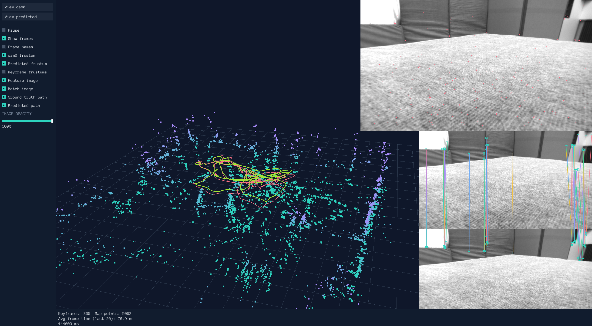

# schlam

A from-scratch visual(-inertial) SLAM playground. The core building blocks of a SLAM frontend — feature detection, matching, RANSAC-based pose estimation, and bundle adjustment — are implemented by hand rather than taken off the shelf, in two parallel implementations:

- **C++** (`schlam/cpp`): the main pipeline, supporting the [EuRoC MAV dataset](https://projects.asl.ethz.ch/datasets/doku.php?id=kmavvisualinertialdatasets) and KITTI Odometry, with configurable Pangolin visualization or headless operation.
- **Python** (`schlam/python`): a PyTorch-based prototyping ground with IMU preintegration, pyceres bundle adjustment, and ROS 2 visualization. Supports EuRoC MAV and KITTI Odometry.

## C++ pipeline

The main executable (`src/main.cpp`) runs a frame-to-frame visual odometry loop:

1. **Data loading** (`src/data`) — threaded EuRoC MAV and KITTI Odometry loaders, selected through the application YAML config. MAV also loads IMU samples and sensor calibration.
2. **Feature detection** (`src/schlam`) — custom FAST and ORB detectors with a quadtree (`QuadTreeNode`) for spatially even keypoint distribution.
3. **Matching** (`Matcher`) — windowed descriptor matching between consecutive frames.
4. **Initial reconstruction** (`Ransac`) — essential matrix estimation with RANSAC, pose recovery, and point triangulation.
5. **Optimization** (`Optimizer`) — two-view bundle adjustment over poses and landmarks using [g2o](https://github.com/RainerKuemmerle/g2o) (Levenberg-Marquardt with Huber kernels).
6. **Visualization** (`src/plotting`) — Pangolin viewer showing the camera frustum, point cloud, and coordinate frames, or `DummyPlotter` for headless runs.

`src/tft` is a small transform-tree library ("tf for the rest of us") for registering and chaining rigid 3D transforms between named coordinate frames (`imu`, `cam0`, `world`, ...).

### Building

The C++ project uses C++23, CMake 3.23 or newer, and Conan 2.24.0. CI uses GCC/G++ 14. Pangolin and g2o are built through the local [Conan recipes](schlam/cpp/recipes/README.md); `conan.lock` pins dependency recipe revisions.

On Ubuntu 24.04, install the [complete system package list](schlam/cpp/recipes/system-packages-ubuntu.txt). This includes the build and graphics dependencies and the system libraries required by the locked Conan recipes for Xorg, keyboard data, VA-API, and VDPAU:

```bash
sudo apt-get update
xargs -r -a schlam/cpp/recipes/system-packages-ubuntu.txt sudo apt-get install -y
```

From the repository root, install Conan in a Python virtual environment and build:

```bash
python3 -m venv .venv-conan
source .venv-conan/bin/activate
python -m pip install conan==2.24.0

export CC=gcc-14
export CXX=g++-14
cd schlam/cpp
conan profile detect --force
conan create recipes/g2o -s build_type=Release -s compiler.cppstd=23 --lockfile=conan.lock --build=missing -c tools.build:jobs="$(nproc)"
conan create recipes/pangolin -s build_type=Release -s compiler.cppstd=23 --lockfile=conan.lock --build=missing -c tools.build:jobs="$(nproc)"
conan install . -s build_type=Release -s compiler.cppstd=23 --lockfile=conan.lock --build=missing -c tools.build:jobs="$(nproc)"
cmake -S . -B build/Release -DCMAKE_TOOLCHAIN_FILE="$PWD/build/Release/generators/conan_toolchain.cmake" -DCMAKE_BUILD_TYPE=Release
cmake --build build/Release --parallel "$(nproc)"
ctest --test-dir build/Release --output-on-failure
```

Replace `Release` with `Debug` throughout to build and test Debug. `conan profile detect --force` replaces the default Conan profile; keep an existing custom profile if you already use one.

### Running

Run these commands from `schlam/cpp`. Pass a YAML config as the executable's argument to select the dataset, sequence, plotter, and component parameters:

| Config | Dataset and sequence | Plotter |
| --- | --- | --- |
| [`config/mav.yaml`](schlam/cpp/config/mav.yaml) | EuRoC MAV, `V1_02_medium` | `PangolinPlotter` |
| [`config/mav_headless.yaml`](schlam/cpp/config/mav_headless.yaml) | EuRoC MAV, `V1_02_medium` | `DummyPlotter` |
| [`config/kitti.yaml`](schlam/cpp/config/kitti.yaml) | KITTI Odometry, `00` | `PangolinPlotter` |

For MAV, set `MAV_PATH` to the directory containing the sequence directories. The loader reads `$MAV_PATH/<dataset.sequence>/mav0`, including `cam0/`, `imu0/`, and `state_groundtruth_estimate0/`:

```bash
export MAV_PATH=/path/to/euroc
build/Release/app config/mav.yaml
# Run without a display or rendering thread:
build/Release/app config/mav_headless.yaml
```

For KITTI, set `KITTI_PATH` to the directory containing the extracted `data_odometry_gray`, `data_odometry_calib`, and `data_odometry_poses` directories:

```bash
export KITTI_PATH=/path/to/kitti
build/Release/app config/kitti.yaml
```

With no argument, `app` uses `config/mav.yaml`. Edit `dataset.sequence` in the selected config to run another sequence. The `tft` executable runs the transform-tree visualization on its own.

### Run results

`SchlamSystem::run()` returns an owned `SchlamResult` after queued local mapping work finishes:

```cpp
const SchlamResult result = schlamSystem.run();
```

| Field | Contents |
| --- | --- |
| `mapPoints` | Latest map point positions as `std::vector<Eigen::Vector3d>`, transformed into world coordinates |
| `predictedPath` | Accepted online camera poses; each `PredictedPose` has a dataset `timestamp`, camera-to-world `rotation`, and world `position` |
| `averageFrameRate` | Processed frames divided by total frame processing time in seconds; excludes viewer pauses and the final mapping wait |

The path includes the reference pose once initialization succeeds and each subsequently accepted pose. Map points and the path are empty if initialization never succeeds. An empty dataset returns zero FPS. Tracking loss returns the map and accepted path accumulated so far. The returned path records online estimates; later bundle adjustment can refine the map without rewriting earlier path poses.

### GitHub Actions

The [C++ workflow](.github/workflows/cpp.yml) runs a Debug and Release matrix:

| Trigger | Runner | Ordered stages |
| --- | --- | --- |
| Every push | Self hosted Linux x64 (`self-hosted`, `linux`, `x64` labels) | Build → run tests → run headless config |
| Pull request | GitHub hosted Ubuntu 24.04 | Build → run tests |

Install the system dependencies listed above on the self hosted runner. The workflow installs Conan and selects Python 3.12. The runner's service account must be able to read the installed MAV dataset at `/home/baldhat/data/mav/vicon_room1/V1_02_medium/mav0`. The job sets `MAV_PATH=/home/baldhat/data/mav/vicon_room1` and runs `config/mav_headless.yaml` with a 30-minute timeout.

Conan uses the runner account's persistent cache, normally `~/.conan2` (or `CONAN_HOME` when configured). `--build=missing` reuses matching g2o and Pangolin binaries on later pushes. Debug and Release need separate binaries; changes to recipes, dependencies, or compiler settings can require rebuilding. Separate runner machines or accounts have separate caches unless configured otherwise.

Self hosted builds use all processors reported by `nproc`. GitHub hosted PR builds use two build jobs to limit memory use. Fresh hosted runners build the local packages from source; no private Conan remote or credentials are required.


## Python pipeline

The Python implementation (`schlam/python/main.py`) mirrors the C++ pipeline but adds:

- **IMU preintegration** (`imu_calc.py`) between camera frames.
- **Sliding-window local bundle adjustment** (`local_bundle_adjustment.py`) over the last N frames using pyceres.
- **Matching** via FLANN or pyramidal Lucas-Kanade optical flow (`matcher.py`).
- **ROS 2 visualization** (`visualizer.py`) publishing camera path, point cloud, and TF frames (view with RViz).

Install dependencies with Poetry (a working ROS 2 installation with `rclpy`/`tf2_ros` is required separately):

```bash
poetry install
```

Set the dataset path and run:

```bash
export KITTI_ODOMETRY_PATH=/path/to/KittiOdometry
python schlam/python/main.py
```

## Repository layout

```
schlam/
├── cpp/
│   ├── src/
│   │   ├── schlam/     # Feature detection, matching, RANSAC, optimization
│   │   ├── config/     # Application config parser and component settings
│   │   ├── data/       # EuRoC MAV and KITTI dataset loading
│   │   ├── tft/        # Rigid transform tree
│   │   └── plotting/   # Pangolin visualization
│   ├── tests/          # GTest unit tests
│   ├── config/         # MAV, KITTI, and headless YAML configs
│   ├── recipes/        # Pinned g2o and Pangolin Conan recipes
│   ├── conanfile.txt    # Conan dependencies
│   └── conan.lock       # Dependency recipe revisions
└── python/             # PyTorch/pyceres prototype pipeline
```
